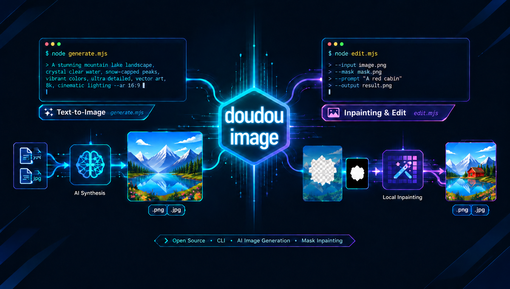

<h1 align="center">豆豆 AI 生图与修图 skill</h1>

<p align="center">
  <b>简体中文</b> | <a href="README_EN.md">English</a>
</p>

基于 New API / 原生 OpenAI 图像接口规范的生图与修图 skill。支持**自然语言文生图**与**图生图 / Mask 局部重绘**。

<p align="center">
  
</p>

---

## 📑 目录导航

- [📖 技能使用指南](#-技能使用指南)
  - [一、安装](#一安装)
  - [二、使用](#二使用)
- [⚙️ 环境配置指南](#️-环境配置指南)
- [💬 交流与支持](#-交流与支持)
- [📄 许可证](#-许可证)

---

## 📖 技能使用指南

本技能库作为 **AI Agent 的图像创作与局部编辑引擎**（原生支持 Antigravity、Claude Code、OpenCode 等平台）。

---

### 一、安装

在任何目标工程根目录下，通过命令行一键安装：

```bash
npx skills add undsky/doudou-image-skill --yes
```

---

### 二、使用

直接用大白话告诉 AI 想要生成什么图片，或提供已有图片进行编辑修改即可：

#### 1. 文生图（生成新图）

```text
帮我画一张赛博朋克风格的猫咪桌面壁纸，高画质
```

#### 2. 修图与局部重绘（修改已有图）

```text
把这张照片里的背景换成雪山日落：./assets/photo.png
```

---

## ⚙️ 环境配置指南

### 1. 配置文件 (`config.json`)

复制技能安装目录或项目根目录下的 `config.json.example` 为 `config.json`，并填入真实凭据：

```json
{
  "default_source": "openai",
  "sources": [
    {
      "id": "openai",
      "name": "OpenAI 官方",
      "url": "https://api.openai.com",
      "key": "sk-xxxxxxxxxxxxxxxxxxxxxxxxxxxx",
      "models": ["dall-e-3", "dall-e-2"]
    },
    {
      "id": "custom",
      "name": "第三方 / 自建 New API",
      "url": "https://api.example.com",
      "key": "sk-xxxxxxxxxxxxxxxxxxxxxxxxxxxx",
      "models": ["gpt-image-2", "gpt-image-2.5"]
    }
  ]
}
```

- **多源切换**：可通过 `--source <id>` 指定 API 源，或通过 `--model <name>` 自动智能路由。
- **配置路径**：脚本会自动查找 `config.json`，亦可通过环境变量 `DOUDOU_IMAGE_CONFIG_FILE` 指定。

### 2. 环境与连通性自检

运行自检命令检查凭据有效性与模型连通性（不消耗生图额度）：

```bash
node scripts/generate.mjs --doctor
```

---

## 💬 交流与支持

|                    公众号                    |                     QQ群                      |
| :------------------------------------------: | :-------------------------------------------: |
|  |  |

---

## 📄 许可证

本项目采用 [CC BY-NC 4.0](LICENSE) 许可证。

- 个人使用、学习、研究与非商业项目可以直接使用。
- 公开发布衍生作品时，请注明来源。
- 商业用途需要单独授权，请联系作者。
