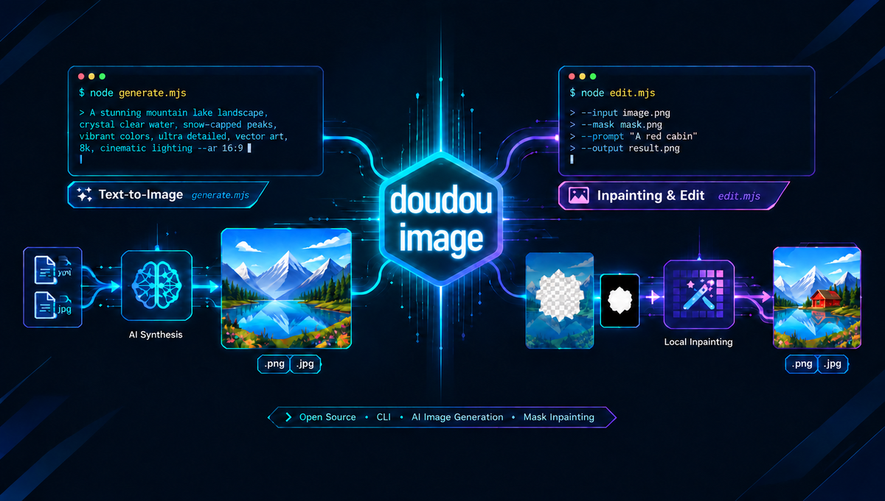

<h1 align="center">Doudou AI Image Generation & Editing Skill</h1>

<p align="center">
  <a href="README.md">简体中文</a> | <b>English</b>
</p>

A native CLI AI image generation and editing tool built on New API / OpenAI image API standards. Features **natural language text-to-image** (generating high-definition illustrations, covers, avatars, and concept art from scratch) and **image-to-image / mask inpainting** (background replacement, style transfer, adding/removing objects, and precise localized inpainting). Built with Node.js 18+ native ESM with zero npm dependencies, automatic image disk saving, and seamless integration with mainstream AI Agent platforms.

<p align="center">
  
</p>

---

## 📑 Table of Contents

- [📖 User Guide](#-user-guide)
  - [1. Installation](#1-installation)
  - [2. Usage](#2-usage)
- [⚙️ Environment Configuration](#️-environment-configuration)
- [💬 Community & Support](#-community--support)
- [📄 License](#-license)

---

## 📖 User Guide

This skill library serves as an **AI Agent's dedicated image generation and localized editing engine** (natively compatible with Antigravity, Claude Code, OpenCode, and more).

---

### 1. Installation

Install effortlessly into any target project root via the command line:

```bash
npx skills add undsky/doudou-image-skill --yes
```

---

### 2. Usage

Simply instruct the AI in natural language to create images or provide existing images for editing:

#### 1. Text-to-Image (Generate New Images)

```text
Draw a cyberpunk style cat desktop wallpaper in high definition
```

Or batch generate using a prompt file to avoid shell escaping issues:

```bash
node scripts/generate.mjs --prompt-file ./prompts/cover.md -n 2
```

#### 2. Image Editing & Localized Inpainting (Modify Existing Images)

```text
Change the background of this photo to a snowy mountain sunset: ./assets/photo.png
```

Or combine with a transparent alpha PNG mask for precision localized inpainting:

```bash
node scripts/edit.mjs photo.png "Draw a potted plant in this area" --mask mask.png
```

---

## ⚙️ Environment Configuration

### 1. Configuration File (`config.json`)

Copy `config.json.example` in the skill root or project root to `config.json`, and configure your providers and credentials:

```json
{
  "sources": [
    {
      "id": "openai",
      "name": "OpenAI Official",
      "url": "https://api.openai.com",
      "key": "sk-xxxxxxxxxxxxxxxxxxxxxxxxxxxx",
      "models": ["dall-e-3", "dall-e-2"]
    },
    {
      "id": "custom",
      "name": "Third-Party / Custom New API",
      "url": "https://api.example.com",
      "key": "sk-xxxxxxxxxxxxxxxxxxxxxxxxxxxx",
      "models": ["gpt-image-2", "gpt-image-2.5"]
    }
  ]
}
```

- **Source Switching**: Switch API sources using `--source <id>`, or let `--model <name>` automatically route to the matching source.
- **Config Path**: The script automatically checks `config.json`, or you can specify a custom path via `DOUDOU_IMAGE_CONFIG_FILE=/path/to/config.json`.

### 2. Environment & Connectivity Doctor

Run the health check command to verify credentials and model connectivity (consumes zero generation credits):

```bash
node scripts/generate.mjs --doctor
```

---

## 💬 Community & Support

| WeChat Official Account | QQ Group |
| :---: | :---: |
|  |  |

---

## 📄 License

This project is licensed under the [CC BY-NC 4.0](LICENSE) License.

- Free for personal use, learning, research, and non-commercial projects.
- When publicly publishing derivative works, please credit the source.
- Commercial use requires separate authorization, please contact the author.
